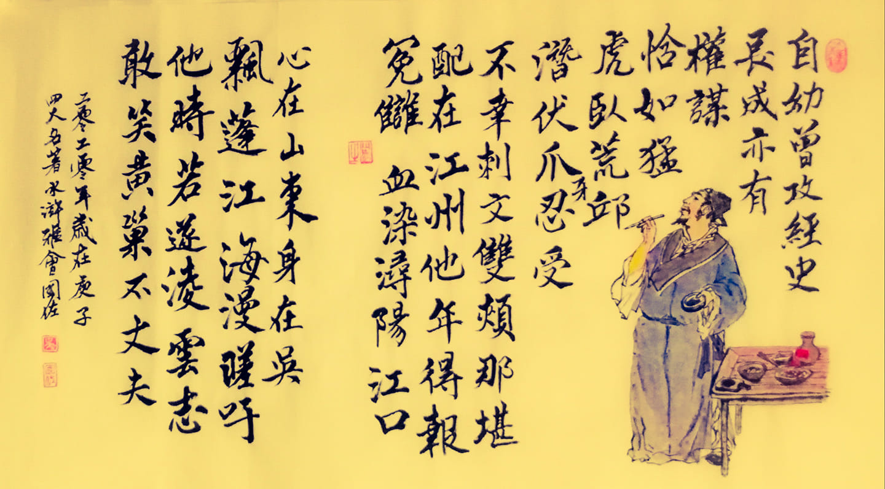

### Hi there 👋

<!--
<div align="center">
    
</div>
^A poem in Chinese, show my figure.
-->

<!--
**SSK015/SSK015** is a ✨ _special_ ✨ repository because its `README.md` (this file) appears on your GitHub profile.

Here are some ideas to get you started:

- 🔭 I’m currently working on ...
- 🌱 I’m currently learning ...
- 👯 I’m looking to collaborate on ...
- 🤔 I’m looking for help with ...
- 💬 Ask me about ...
- 📫 How to reach me: ...
- 😄 Pronouns: ...
- ⚡ Fun fact: ...
-->

- 🔭 I am currently a 2nd-year Phd Student @[**ICT, CAS**] (enrolled in Sep. 2025), major in computer systems. I am lucky to work with professor [**Chenxi Wang**](https://wangchenxi7.github.io/home/).
- 💬 I got my bachelor degree from CS school of HUST (Huazhong University of Science & Technology) in 2025.6.
- 🌱 Learning **Operating Systems**, **Memory Management** and other interesting things about **Computer Systems**.
- 🤔 Ask me about anything.
- [](https://skillicons.dev)
- 👯 [My static blog here](https://ssk015.github.io/) <!-- - 🤔 [My dynamic blog here](https://pochengqiru.cn/)-->
- 📫 How to reach me: Email **xiayanwen25@mails.ucas.ac.cn** · **yenwenshare@gmail.com**, wechat **18252677381**, QQ **2437103317**.
- ⚡ Interests: I'm working on **Computer Systems** and Agent related Systems.
- 👯 Collaborate in: [**HUST**](https://hust.edu.cn/) · [**Heptagon**](https://github.com/heptagonhust) · *2022-2025*. Competed in several HPC-realted competitions(also known as SCC), like ASC.
- Others: My Github avatar comes from a song titled ["Umiyuri Kaiteitan"](https://www.youtube.com/watch?v=7JANm3jOb2k) sang by Hatsune Miku, composed by nbuna.

<div align="center">

   
 

    
<!-- [](https://github.com/anuraghazra/github-readme-stats) -->
    
<!-- [](https://github.com/anuraghazra/github-readme-stats) -->
</div>

<div align="center">
    
</div>


 <table align="center">
  <tr>
    <td>Visitors</td>
    <td><a align= "center" href="https://github.com/ssk015"></a></td>
  </tr>
</table>

I once played coding for a long time (before the era of LLM and Agents). 

### 📊 My WakaTime Coding Stats  
<!--START_SECTION:waka-->


**🐱 My GitHub Data** 

> 📦 ? Used in GitHub's Storage 
 > 
> 🏆 428 Contributions in the Year 2026
 > 
> 🚫 Not Opted to Hire
 > 
> 📜 62 Public Repositories 
 > 
> 🔑 0 Private Repositories 
 > 
📅 **I'm Most Productive on Friday** 

```text
Monday                   231 commits         ████░░░░░░░░░░░░░░░░░░░░░   17.41 % 
Tuesday                  243 commits         █████░░░░░░░░░░░░░░░░░░░░   18.31 % 
Wednesday                144 commits         ███░░░░░░░░░░░░░░░░░░░░░░   10.85 % 
Thursday                 99 commits          ██░░░░░░░░░░░░░░░░░░░░░░░   07.46 % 
Friday                   304 commits         ██████░░░░░░░░░░░░░░░░░░░   22.91 % 
Saturday                 176 commits         ███░░░░░░░░░░░░░░░░░░░░░░   13.26 % 
Sunday                   130 commits         ██░░░░░░░░░░░░░░░░░░░░░░░   09.80 % 
```


📊 **This Week I Spent My Time On** 

```text
🕑︎ Time Zone: Asia/Shanghai

💬 Programming Languages: 
Other                    21 hrs 30 mins      ████████████░░░░░░░░░░░░░   49.68 % 
CSV                      12 hrs 48 mins      ███████░░░░░░░░░░░░░░░░░░   29.59 % 
Python                   5 hrs 22 mins       ███░░░░░░░░░░░░░░░░░░░░░░   12.42 % 
JavaScript               1 hr 13 mins        █░░░░░░░░░░░░░░░░░░░░░░░░   02.81 % 
HTML                     1 hr 3 mins         █░░░░░░░░░░░░░░░░░░░░░░░░   02.46 % 

🔥 Editors: 
Cursor                   43 hrs 5 mins       █████████████████████████   99.57 % 
Codex Vscode             11 mins             ░░░░░░░░░░░░░░░░░░░░░░░░░   00.43 % 

💻 Operating System: 
Windows                  43 hrs 16 mins      █████████████████████████   100.00 % 
```

🤖 **AI Coding This Week** 

```text
⏱ AI Coding Time: 43 hrs 16 mins (100.0%)

✍️ 1,097 lines written by AI, 32 lines written by hand (97.17% AI-written)

🔤 80,678,950 Input Tokens, 14,430,093 Output Tokens

💵 $1487.33 Estimated AI Cost This Week

🧠 141 AI Sessions, 663 AI Prompts

GPT                      1,098 lines         █████████████████████████   100.00 % 

🔎 AI Coding Insights:
🤖 AI-Driven — 97.17% of written lines came from AI
📝 Concise Prompter — average 147 characters per prompt
🔁 Iterative Prompter — average 5 prompts per session
🚀 High AI Trust — 3.09% of changed lines were hand-edited
```

**I Mostly Code in C++** 

```text
C++                      8 repos             ████████░░░░░░░░░░░░░░░░░   30.77 % 
Python                   6 repos             ██████░░░░░░░░░░░░░░░░░░░   23.08 % 
Shell                    3 repos             ███░░░░░░░░░░░░░░░░░░░░░░   11.54 % 
JavaScript               1 repo              █░░░░░░░░░░░░░░░░░░░░░░░░   03.85 % 
HTML                     1 repo              █░░░░░░░░░░░░░░░░░░░░░░░░   03.85 % 
```


 Last Updated on 25/10/2026 03:09:48 UTC
<!--END_SECTION:waka-->


